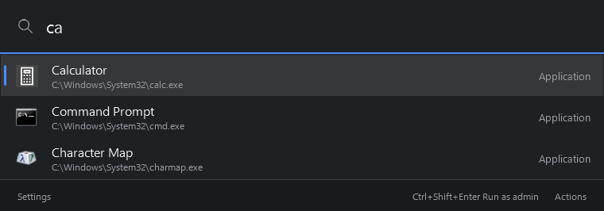
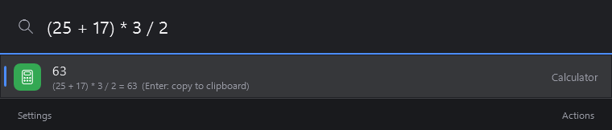
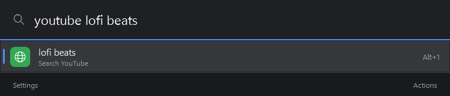
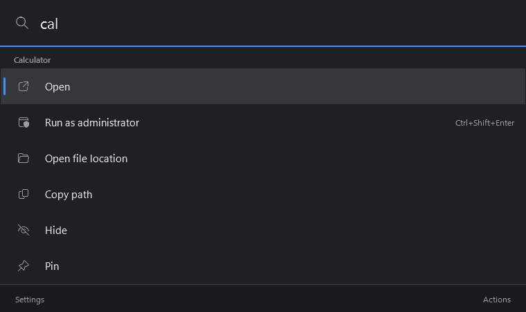
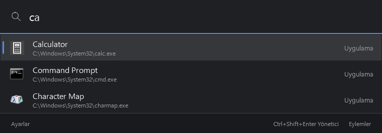
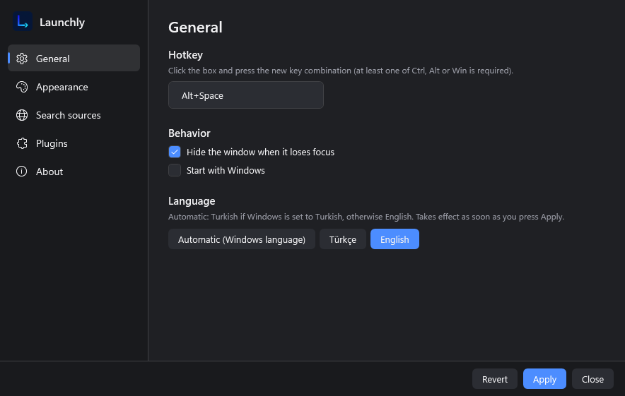
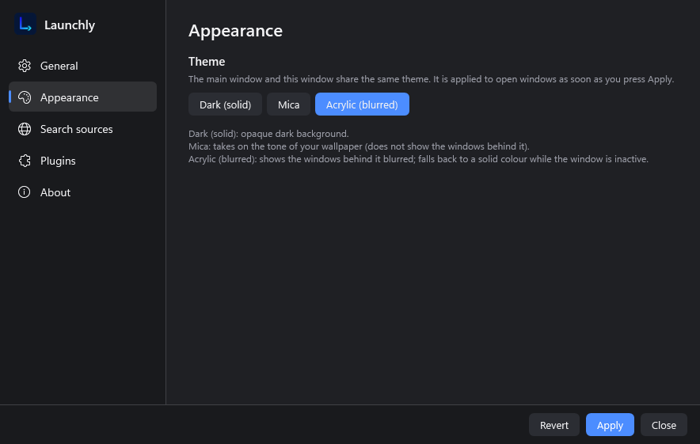
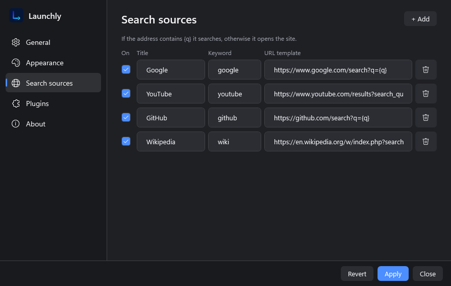
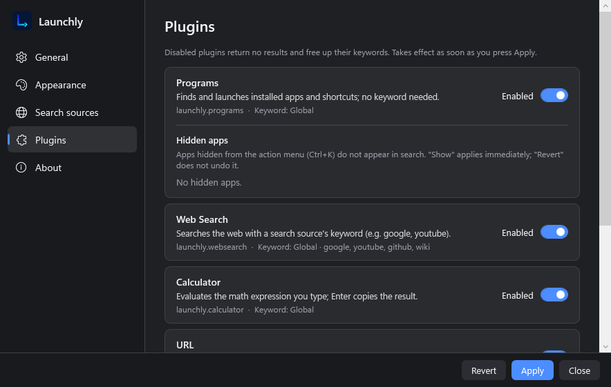
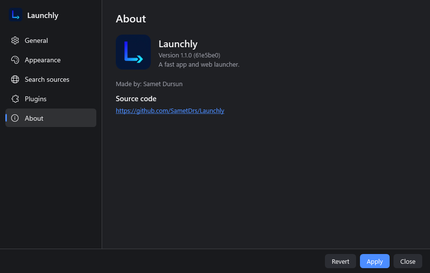

# Launchly

English | [Türkçe](README.tr.md)

Launchly is a keyboard-driven app and web launcher for Windows. Press a hotkey, type, and press Enter to start a program, search the web, evaluate an expression or open a file.



## Features

- **Program search.** Finds installed apps and shortcuts as you type. Results are ranked by match quality and by how often and how recently you launched each program.
- **Web search and custom search sources.** Type a source keyword followed by your query (`google`, `youtube` and `github` are included). Add, edit, disable or remove sources in Settings; an address that contains `{q}` becomes a search, an address without it simply opens the site.
- **Calculator.** Type a math expression to see the result; Enter copies it to the clipboard.
- **File search.** `f <name>` searches your Desktop, Documents, Pictures, Music, Videos and Downloads folders by file name.
- **System commands.** Lock, Sleep, Shutdown, Restart and Empty Recycle Bin. Shutdown, Restart and Empty Recycle Bin ask for confirmation.
- **URL opening.** Typing a web address offers to open it in your default browser.
- **Action menu.** `Ctrl+K` opens a menu for the selected result (run as administrator, open file location, copy path, hide, pin).
- **Run as administrator.** `Ctrl+Shift+Enter` runs the selected program elevated.
- **Hide and pin.** With an empty search box, pinned and most-used programs are listed first; hidden programs no longer appear in search and can be restored from Settings > Plugins.
- **Tray icon and autostart.** Launchly lives in the notification area and can start with Windows.
- **Themes.** Solid dark, Mica or Acrylic backdrop (Mica and Acrylic need Windows 11 22H2 or later; otherwise a solid dark theme is used).
- **Languages.** English and Turkish, selectable in Settings or chosen automatically from the Windows display language.

| | |
|---|---|
|  |  |
|  |  |

## Install

1. Download `Launchly-Setup.exe` from the [Releases](https://github.com/SametDrs/Launchly/releases) page.
2. Run it. No administrator rights are needed (it installs for the current user), and the .NET runtime does not have to be installed.

Requirements: Windows 10 (version 2004, build 19041) or Windows 11, 64-bit.

## Usage

- Press **Alt+Space** to show or hide the window (changeable in Settings > General).
- Type to search. Use **Up/Down** to move, **Enter** to run, **Tab** to autocomplete, **Alt+1 ... Alt+9** to pick a result by number and **Esc** to close the window or the action menu.
- Keywords:
  - `google <text>`, `youtube <text>`, `github <text>` search the web (plus any sources you add).
  - `f <name>` searches files.
  - Programs, the calculator, URLs and system commands (`lock`, `sleep`, `shutdown`, `restart`, `recycle`) need no keyword.
- `Ctrl+K` opens the action menu, `Ctrl+Shift+Enter` runs a program as administrator.

## Settings

Open Settings from the footer of the main window or from the tray icon.

| General | Appearance |
|---|---|
|  |  |
| **Search sources** | **Plugins** |
|  |  |
| **About** | |
|  | |

## Build from source

Requires the .NET 9 SDK on Windows.

```powershell
dotnet build Launchly.sln
dotnet test
```

To produce the installer, install [Inno Setup 6](https://jrsoftware.org/isinfo.php) and run:

```powershell
installer\build.ps1
```

The script publishes a self-contained win-x64 build and writes `artifacts\Launchly-Setup.exe`.

## Project structure

```
src/
  Launchly.Plugin/    Plugin SDK: IPlugin, Query, Result (no dependencies)
  Launchly.Core/      Query building, plugin manager, string matching, settings, JSON storage, localization
  Launchly.App/       WPF application: windows, view models, theme, hotkey, tray
  Launchly.Plugins/   Built-in plugins: Programs, WebSearch, Calculator, Files, System, Url
tests/
  Launchly.Tests/     xUnit tests
```

## License

MIT. See [LICENSE](LICENSE). Copyright Samet Dursun.
