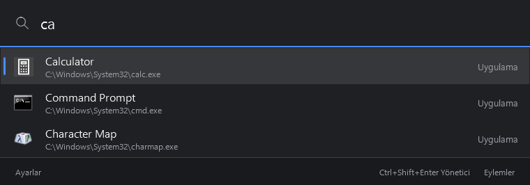
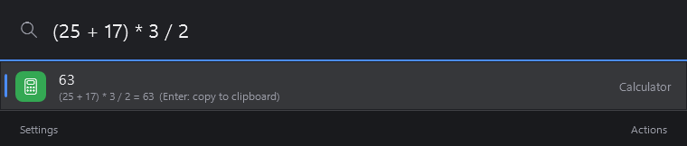
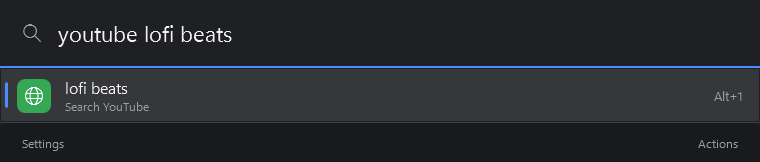
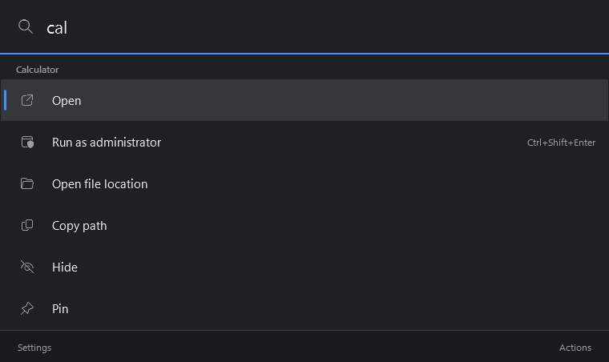
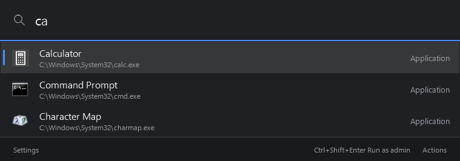
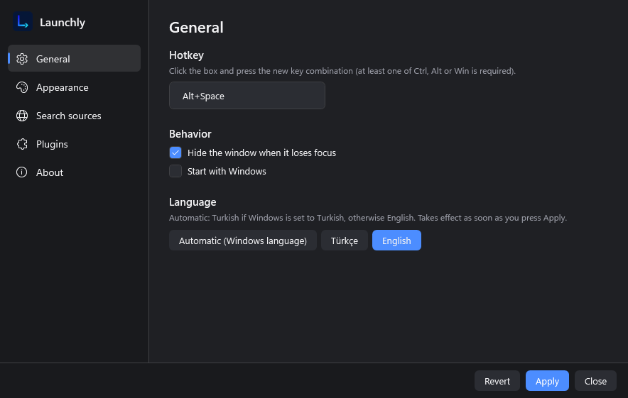
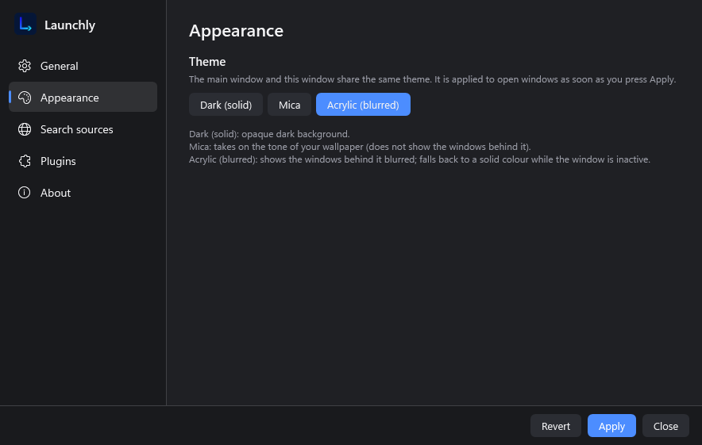
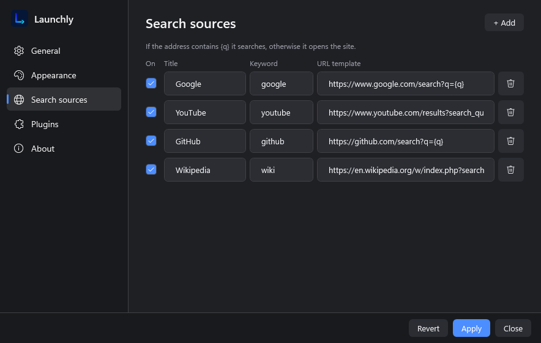
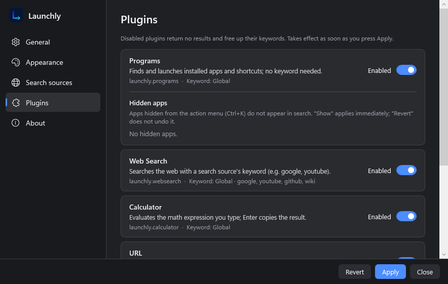
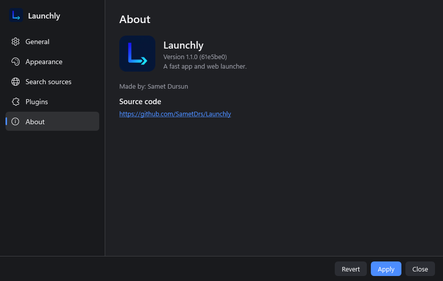

# Launchly

[English](README.md) | Türkçe

Launchly, Windows için klavye odaklı bir uygulama ve web başlatıcısıdır. Kısayola bas, yaz, Enter'a bas: program başlatır, web'de arar, ifade hesaplar ya da dosya açar.

> Aşağıdaki ekran görüntüleri İngilizce arayüzle alınmıştır; arayüz dili Ayarlar'dan Türkçe yapılabilir.



## Özellikler

- **Program arama.** Yüklü uygulamaları ve kısayolları yazarken bulur. Sonuçlar eşleşme kalitesine ve her programı ne sıklıkla, ne kadar yakın zamanda başlattığına göre sıralanır.
- **Web araması ve özel arama kaynakları.** Kaynağın anahtar kelimesini ve ardından sorguyu yaz (`google`, `youtube` ve `github` hazır gelir). Kaynakları Ayarlar'dan ekleyebilir, düzenleyebilir, kapatabilir ya da silebilirsin; adreste `{q}` varsa arama yapılır, yoksa site doğrudan açılır.
- **Hesap makinesi.** Bir matematik ifadesi yaz, sonucu gör; Enter sonucu panoya kopyalar.
- **Dosya arama.** `f <ad>` Masaüstü, Belgeler, Resimler, Müzik, Videolar ve İndirilenler klasörlerinde dosya adına göre arar.
- **Sistem komutları.** Kilitle, Uyku, Kapat, Yeniden başlat ve Geri dönüşüm kutusunu boşalt. Kapat, Yeniden başlat ve Geri dönüşüm kutusunu boşalt onay ister.
- **URL açma.** Bir web adresi yazınca varsayılan tarayıcıda açmayı önerir.
- **Eylem menüsü.** `Ctrl+K` seçili sonuç için menü açar (yönetici olarak çalıştır, dosya konumunu aç, yolu kopyala, gizle, sabitle).
- **Yönetici olarak çalıştır.** `Ctrl+Shift+Enter` seçili programı yönetici olarak çalıştırır.
- **Gizle ve sabitle.** Arama kutusu boşken sabitlenen ve en çok kullanılan programlar önce listelenir; gizlenen programlar aramada çıkmaz ve Ayarlar > Eklentiler'den geri getirilebilir.
- **Tepsi simgesi ve otomatik başlatma.** Launchly bildirim alanında durur ve Windows ile birlikte başlayabilir.
- **Temalar.** Düz koyu, Mica ya da Acrylic arka plan (Mica ve Acrylic için Windows 11 22H2 veya üstü gerekir; yoksa düz koyu tema kullanılır).
- **Diller.** Türkçe ve İngilizce; Ayarlar'dan seçilir ya da Windows görüntüleme dilinden otomatik belirlenir.

| | |
|---|---|
|  |  |
|  |  |

## Kurulum

1. [Releases](https://github.com/SametDrs/Launchly/releases) sayfasından `Launchly-Setup.exe` dosyasını indir.
2. Çalıştır. Yönetici izni gerekmez (geçerli kullanıcı için kurulur) ve .NET çalışma zamanının kurulu olması gerekmez.

Gereksinimler: Windows 10 (sürüm 2004, derleme 19041) veya Windows 11, 64 bit.

## Kullanım

- Pencereyi açıp kapatmak için **Alt+Space** tuşlarına bas (Ayarlar > Genel'den değiştirilebilir).
- Aramak için yaz. **Yukarı/Aşağı** ile gez, **Enter** ile çalıştır, **Tab** ile tamamla, **Alt+1 ... Alt+9** ile sonucu numarasıyla seç, **Esc** ile pencereyi ya da eylem menüsünü kapat.
- Anahtar kelimeler:
  - `google <metin>`, `youtube <metin>`, `github <metin>` web'de arar (eklediğin kaynaklar da).
  - `f <ad>` dosya arar.
  - Programlar, hesap makinesi, URL ve sistem komutları (`lock`, `sleep`, `shutdown`, `restart`, `recycle`; Türkçe arayüzde Türkçe adlarıyla da) anahtar kelime gerektirmez.
- `Ctrl+K` eylem menüsünü açar, `Ctrl+Shift+Enter` programı yönetici olarak çalıştırır.

## Ayarlar

Ayarlar'ı ana pencerenin alt çubuğundan ya da tepsi simgesinden aç.

| Genel | Görünüm |
|---|---|
|  |  |
| **Arama kaynakları** | **Eklentiler** |
|  |  |
| **Hakkında** | |
|  | |

## Kaynaktan derleme

Windows üzerinde .NET 9 SDK gerekir.

```powershell
dotnet build Launchly.sln
dotnet test
```

Kurulum dosyasını üretmek için [Inno Setup 6](https://jrsoftware.org/isinfo.php) kur ve şunu çalıştır:

```powershell
installer\build.ps1
```

Betik, kendi içinde çalışma zamanını taşıyan bir win-x64 derlemesi yayımlar ve `artifacts\Launchly-Setup.exe` dosyasını üretir.

## Proje yapısı

```
src/
  Launchly.Plugin/    Eklenti SDK'sı: IPlugin, Query, Result (bağımlılık yok)
  Launchly.Core/      Sorgu oluşturma, eklenti yöneticisi, metin eşleştirme, ayarlar, JSON depolama, yerelleştirme
  Launchly.App/       WPF uygulaması: pencereler, görünüm modelleri, tema, kısayol, tepsi
  Launchly.Plugins/   Dahili eklentiler: Programs, WebSearch, Calculator, Files, System, Url
tests/
  Launchly.Tests/     xUnit testleri
```

## Lisans

MIT. Bkz. [LICENSE](LICENSE). Telif: Samet Dursun.
